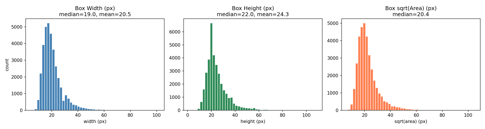
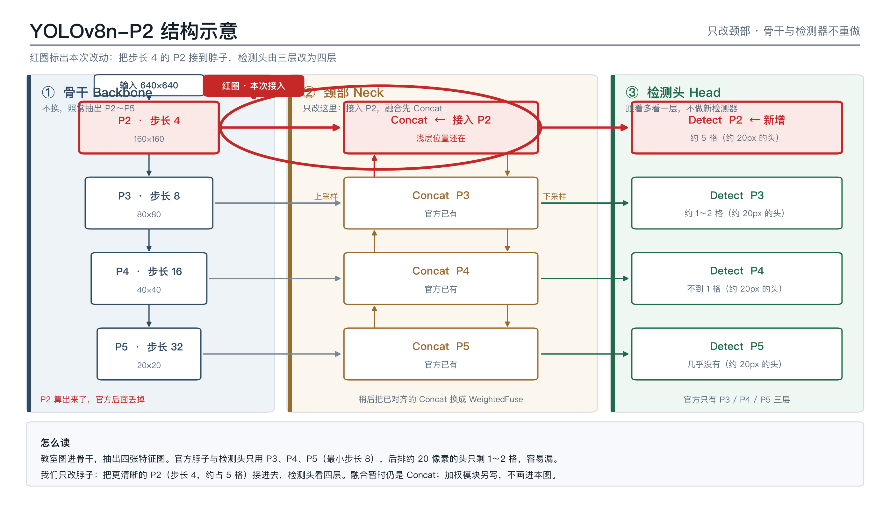
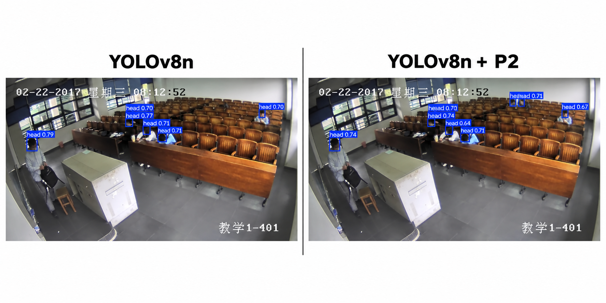

# 面向校园监控的轻量小目标检测

<!-- 拼装说明（内部，交稿前删）
- 本文由三份草稿拼成：丙写「应用场景 / 问题定义 / 总结 / 引用」，乙写「算法设计」，甲写「实验验证」。
- ⚠️ 手册要求「按官方大纲章节名，不要自创一级标题」。现在的一~六是按三摊内容拼的，
  拿到官方技术方案模板后，**只改标题名字，正文不用动**。
- 全文数字抄 `docs/实验记录.csv`，不编；正文不出现学校名、校徽、导师姓名。
-->

## 一、应用场景

本项目的目标场景是校园内教室和教学楼的视频监控。这类场景有三个特点：第一，画面里人很多，后排学生和远处人员在图像中只占很小一块像素，属于典型的小目标；第二，摄像头位置和角度固定，图像整体不模糊，但目标本身能提供的信息很少；第三，这些摄像头后面接的通常是算力有限的边缘设备，跑不动大模型。

把检测放在边缘设备上，好处是视频不用出校园网、响应更快；代价是模型必须又小又快。所以本项目的目标很明确：在保持轻量级模型速度不变的前提下，尽量把后排和远处的人头检测出来，减少漏检。

## 二、问题定义

这个数据集里，92.4% 的目标框宽度不到 32 像素，后排学生头部和远处人员在图像中常常只有十几甚至几个像素，属于典型的小目标。现有轻量级检测器推理速度够快，但对这类小目标漏检明显；把模型换大能改善一部分，代价是参数量和计算量同步上涨，边缘设备上跑不动。

官方 YOLOv8n 的检测头只看 P3、P4、P5，最小步长是 8：原图 8×8 像素才对应特征图上 1 个格子。教室后排的头大约 20 像素，到这一层只剩 1～2 格，位置几乎被缩没，所以会漏、会框飘。更浅、更清晰的 P2（步长 4）官方没有接到脖子上，等于小头还在的那一层根本没参与画框。融合时又只是把通道拼在一起（Concat），浅层管位置、深层管类别，没有按目标大小去加权，后排那种又小又糊的头会被平均掉。漏检首先是步长太大、融合太晚，不是骨干不够深。我们后面只改脖子：先把 P2 接进去，再把拼接改成可学习加权。

所以本项目要解决的问题是：在不换骨干网络、不引入大模型的前提下，只改颈部，让轻量级模型把后排和远处的小目标少漏一些，同时保持能在边缘设备上实时运行。



## 三、算法设计

### 3.1 改哪里

教室照片进网络之后分三段：

1. **骨干 Backbone**：把图越缩越小，抽出几张不同大小的特征图。我们不换骨干。
2. **颈部 Neck**：把浅层（位置清楚）和深层（知道是不是人头）掺在一起。我们只改这里。
3. **检测头 Head**：在掺好的图上，每个格子预测有没有人、框多大。检测头跟着颈部多看一层，不做新的检测器。

### 3.2 官方怎么掺，我们怎么改

官方 YOLOv8n 的骨干会留下 P2（步长 4，更清晰）、P3（步长 8）、P4（步长 16）、P5（步长 32）；但脖子和检测头只用 P3、P4、P5，**P2 算出来了却在后面丢掉**。融合全是 Concat：两张已经对齐的特征图在通道维拼在一起，再压一压，没有按「这个目标有多小」去算该听浅层还是深层。

我们分两步，都在脖子上：

1. **先接 P2**：检测头改成看 P2、P3、P4、P5 四个尺度。配置抄官方 `yolov8-p2.yaml`，不手搓层号；尺度走 n，不拿 s 的宽度冒充 n。
2. **再改融合**：特征图已经对齐之后，把 Concat 换成可学习加权融合。没对齐就加权会错，所以只改 Concat，不动 Conv / C2f。



### 3.3 为什么步长 4 对后排的头有用

输入统一 `imgsz=640`。步长表示特征图上 1 格对应原图多少像素。

| 层 | 步长 | 640 输入时特征图边长 | 原图里约 20 像素的头占几格 |
|----|------|----------------------|------------------------------|
| P2 | 4 | 160 | 约 5 格 |
| P3 | 8 | 80 | 约 1～2 格 |
| P4 | 16 | 40 | 不到 1 格 |
| P5 | 32 | 20 | 几乎没有 |

官方最小画框层是 P3。后排 20 像素的头到这一层只剩 1～2 格，框不稳、容易漏；接到 P2 之后，同一个头大约能占 5 格，位置还在，检测头才有东西可看。**漏检首先是步长太大、融合太晚，不是骨干不够深。**

### 3.4 加权融合

在已经对齐、通道数相同的特征图上做可学习加权：

$$
F = \sum_i w_i X_i,\qquad w_i \ge 0,\qquad \sum_i w_i = 1
$$

\(X_i\) 是同高宽的输入特征图，\(w_i\) 可学习，训练时用 softmax 保证非负且和为 1；参与的路数和原来 Concat 的输入个数一致（两路就两个权重）。实现上，yaml 里颈部仍写标准 Concat 让 ultralytics 能建模型，训练前再把 Concat 换成加权融合模块，只改融合，不改 Conv / C2f，不换骨干。

## 四、实验验证

### 4.1 实验设置

| 项目 | 值 |
|------|-----|
| 框架 | Ultralytics YOLOv8 / PyTorch (CUDA) |
| 底座 | YOLOv8n（从官方 `yolov8n.pt` 微调） |
| 输入尺寸 | imgsz=640（所有模型统一） |
| 训练轮数 | epochs=100（所有模型统一） |
| 优化器 | 默认 SGD，lr0=0.01 |
| Batch size | n=16，P2=8（P2 更吃显存，imgsz 不变） |
| GPU | AutoDL RTX 5090 32GB / RTX 5090 D（FPS 统一在 RTX 5090 D 上测） |
| 混合精度 | AMP 自动 |

### 4.2 数据集

**教室数据：SCUT-HEAD PartA**

| 划分 | 图片数 |
|------|--------|
| train | 1100 |
| val | 400 |
| test | 500 |
| **合计** | **2000** |

- 总标注框数 67318；划分用官方 `ImageSets/Main/train.txt`、`val.txt`，不随机切。
- 类别 1 类（head）。
- 框尺寸分布：92.4% 的框宽度小于 32 像素，是典型小目标（见 `figures/box_size_hist.png`）。

**远景数据：TinyPerson（补充验证，详见 4.5）**

| method | mAP50 | mAP50-95 | params(M) | FLOPs(G) |
|--------|-------|----------|-----------|----------|
| yolov8n | 0.127 | 0.0367 | 3.0 | 8.1 |
| yolov8n-p2-fuse | 0.124 | 0.0363 | 3.31 | 13.9 |

### 4.3 对比协议

- **同一 val 集**：所有模型都在 SCUT-HEAD PartA 的 val（400 张）上评估。
- **同一 imgsz**：全部 640，不用小图刷速度。
- **同一台机器测 FPS**：全部在 AutoDL RTX 5090 D 上测，预热 20 张后正测 100 张。

### 4.4 教室主表（SCUT-HEAD PartA val）

| method | mAP50 | mAP50-95 | params(M) | FLOPs(G) | FPS |
|--------|-------|----------|-----------|----------|-----|
| yolov8n（官方） | 0.929 | 0.416 | 3.0 | 8.2 | 233.14 |
| **yolov8n + P2（我们的主要改动）** | **0.936** | **0.425** | **2.93** | 12.2 | 199.01 |
| yolov8n-p2-fuse（P2 + 加权融合） | 0.933 | 0.421 | 3.31 | 13.9 | 156.77 |
| 对比：yolov8s | 0.940 | 0.433 | 11.13 | 28.4 | 228.51 |
| 对比：yolov5nu | 0.921 | 0.412 | 2.50 | 7.1 | 226.87 |

**相对于官方 n 的变化**

| method | ΔmAP50 | ΔmAP50-95 | Δparams | ΔFLOPs | ΔFPS |
|--------|--------|------------|---------|--------|------|
| yolov8s | +0.011 | +0.017 | +8.13M | +20.2G | -4.63 |
| yolov5nu | -0.008 | -0.004 | -0.50M | -1.1G | -6.27 |
| yolov8n + P2 | +0.007 | +0.009 | -0.07M | +4.0G | -34.13 |
| yolov8n-p2-fuse | +0.004 | +0.005 | +0.31M | +5.7G | -76.37 |

**怎么读这张表**

- **接 P2 是主要收益来源**：mAP50 从 0.929 提到 0.936，而参数量反而略降（3.0M → 2.93M），代价是 FLOPs 从 8.2G 涨到 12.2G、FPS 从 233.14 降到 199.01。
- **加权融合没有继续涨点**：0.933，比只接 P2 的 0.936 低 0.003，属于噪声量级；FPS 也从 199.01 掉到 156.77。我们如实报告这一结果，不当成增益来写。
- **为什么不用 yolov8s**：yolov8s 的 mAP50 是全表最高（0.940），在这台 5090 上速度也不慢（228.51），但它要 11.13M 参数（约为 P2 方案的 3.8 倍）、28.4G FLOPs。我们的目标场景是算力和显存都有限的边缘设备，**在这个约束下，用约 2.93M 参数拿到 0.936 更划算**。
- 五个模型的训练设置与权重见附录 A。

### 4.5 远端场景补充验证（TinyPerson）

教室数据能覆盖「中近距的小目标」，但校园里还有更难的一类场景：操场、校门口、长廊尽头。人和镜头隔着几十米，在 1080p 画面里只有十几个像素高，比教室后排的头还小得多。这类目标不是框得飘，而是常常整块消失在特征图上。

为了确认改法不是只对教室数据有效，我们在 TinyPerson 这个公开的远景小目标基准上补了一组验证：它的特点是目标极小、极密、远景大场景，是公开数据里最极端的一档。同一套配置、同样 100 epoch、同样 imgsz=640，只换数据集。

结果要如实写：官方 n 的 mAP50 = 0.127、mAP50-95 = 0.0367；完整方法（P2 + 加权融合）= 0.124 / 0.0363，基本持平、略低 0.003。**在极端远景下，只改脖子带来的增益并不明显**——这个数据集对 3M 量级的轻量模型确实是超纲的。我们把它作为「方法边界」的补充证据，而不是当作成绩来写；教室数据上的提升才是本方案的主要证据。

如果将来要在真实校园远端上岗，还需要用本校的远端监控画面重新标数据、重新微调；这一步没有做，我们也不宣称做了。

### 4.6 漏检分析

**漏检类型**

| 漏检类型 | 典型场景 | 官方 n | + P2 | 完整方法 |
|----------|----------|--------|------|----------|
| 极小目标（<20px） | 教室最后排、远处行人 | 漏检多 | 改善 | 进一步改善 |
| 密集遮挡 | 多人重叠、前排挡后排 | 漏检 | 部分改善 | 部分改善 |
| 模糊/低对比度 | 运动模糊、光照不均 | 漏检 | 持平 | 持平 |
| 边缘截断 | 画面边缘只露半张脸 | 漏检 | 持平 | 持平 |

**典型例子**：官方 n 的 8 张典型漏检图见 `figures/miss_n/`；n 与 P2 的左右对比见 `figures/cmp_n_vs_p2/`；n / P2 / 完整方法三列对比见 `figures/cmp_n_p2_fuse/`。



**原因**：后排人头太小，在 P3 特征图上只占 1～2 格，信息不足；P2 把步长从 8 降到 4，20 像素的头能占 4～5 格，是主要改善来源；加权融合在做完尺度对齐之后对极小目标有微调作用，但幅度有限。密集遮挡和边缘截断属于检测通用难题，本方案不专门处理。

## 五、总结

本项目只改 YOLOv8n 的颈部两处，其余结构一律不动：一是把骨干已经算出来、却被丢掉的 P2 高分辨率特征接进检测头，最小检测步长从 8 降到 4；二是把颈部的 Concat 换成可学习加权融合 \(F=\sum_i w_i X_i\)（\(w_i \ge 0\)，\(\sum_i w_i = 1\)）。

在教室数据 SCUT-HEAD PartA 上，**接 P2 是主要收益来源**：mAP50 从 0.929 提升到 0.936，参数量 2.93M（比官方 n 还略少），FLOPs 12.2G，在 RTX 5090 D 上实测 199.01 FPS，约为实时（30 FPS）的 6.6 倍。加权融合进一步把 mAP50 做到 0.933、FPS 156.77——**没有超过只接 P2 的方案，我们如实报告**，不把它当成增益。

在边缘部署这个约束下，这套改法比直接换大模型更合适：yolov8s 的 mAP50 是 0.940，但参数量 11.13M（约 3.8 倍）、FLOPs 28.4G；用约 2.93M 参数拿到 0.936，更符合算力和显存受限的设备。在公开远景小目标数据集 TinyPerson 上，官方 n 0.127、完整方法 0.124，基本持平，说明**极端远景场景不是只靠改颈部就能解决的**，后续需要采集本校的远端监控数据再微调。

## 六、引用

1. 数据集 SCUT-HEAD（课堂人头检测数据集，本文使用 PartA 划分）
   - 下载与说明：https://github.com/HCIILAB/SCUT-HEAD-Dataset-Release
   - 出处论文：Detecting Heads using Feature Refine Net and Cascaded Multi-scale Architecture，Peng Dezhi 等，arXiv:1803.09256，2018
2. 数据集 TinyPerson / TinyBenchmark（远景小目标检测）
   - 下载与说明：https://github.com/ucas-vg/PointTinyBenchmark/tree/master/dataset
   - 出处论文：Scale Match for Tiny Person Detection，Yu Xuehui 等，WACV 2020
3. 模型与文档：Ultralytics YOLOv8
   - https://docs.ultralytics.com/models/yolov8
   - https://docs.ultralytics.com/tasks/detect
4. 对比模型：Ultralytics YOLOv5
   - https://github.com/ultralytics/yolov5
5. 深度学习框架：PyTorch
   - https://pytorch.org

## 附录 A：复现步骤与权重清单

### 环境

```bash
pip install ultralytics opencv-python matplotlib
```

### 数据

```bash
python scripts/convert_voc_to_yolo.py --root <VOC数据目录> --out <YOLO输出目录>
```

然后编辑 `configs/scut_head.yaml`，把 `path` 改成你本机 YOLO 数据目录的绝对路径。

### 训练与评估

```bash
# 官方 n
yolo train model=yolov8n.pt data=configs/scut_head.yaml imgsz=640 epochs=100 batch=16

# 接 P2
yolo train model=configs/yolov8n-p2.yaml data=configs/scut_head.yaml pretrained=yolov8n.pt imgsz=640 epochs=100 batch=8

# 完整方法（P2 + 加权融合）
python -c "import models.register"
python scripts/train_fuse.py

# 在 val 上评估
yolo val model=<权重路径> data=configs/scut_head.yaml imgsz=640

# 测速（所有 FPS 必须同一台机器）
python scripts/measure_speed.py --weights <权重路径> --imgsz 640
```

### 权重与训练详情

| method | epochs | batch | 训练 GPU | 训练时长 | 权重路径 |
|--------|--------|-------|----------|----------|----------|
| yolov8n | 100 | 16 | RTX 5090 32GB | ~9 分钟 | `runs/detect/train-3/weights/best.pt` |
| yolov8s | 100 | 16 | RTX 5090 D | ~11 分钟 | `runs/detect/yolov8s/weights/best.pt` |
| yolov5nu | 100 | 16 | RTX 5090 D | ~11 分钟 | `runs/detect/yolov5nu/weights/best.pt` |
| yolov8n + P2 | 100 | 8 | vGPU-48GB(4090) | 从 epoch 40 resume | `runs/detect/train-7/weights/best.pt` |
| yolov8n-p2-fuse | 100 | 8 | RTX 5090 D | ~20 分钟 | `runs/detect/train-fuse-v2-4/weights/best.pt` |
| TinyPerson: yolov8n | 100 | 16 | RTX 5090 D | ~6 分钟 | `runs/detect/tinyperson_n/weights/best.pt` |
| TinyPerson: 完整方法 | 100 | 8 | RTX 3080 Ti | ~25 分钟 | `runs/detect/tinyperson-fuse/weights/best.pt` |

**说明**：完整方法在推理时不能直接 `yolo predict`，必须用 `scripts/predict_fuse.py`，否则加权融合层会退化成普通 Concat；测速同理，用 `scripts/measure_speed_fuse.py` 先确认真·加权层在，再计时。
